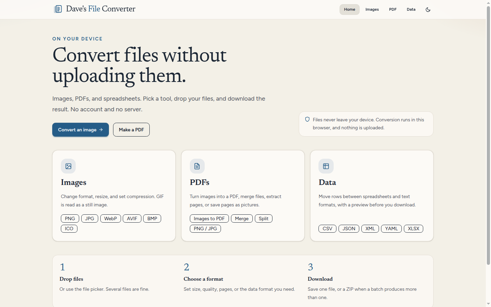
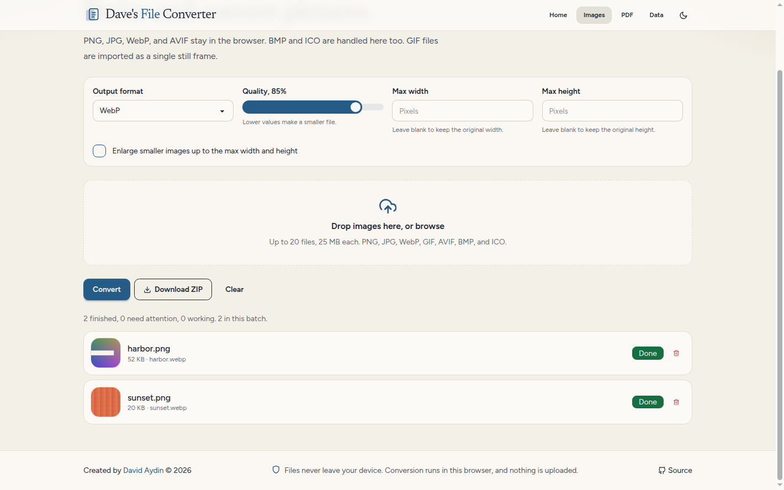

# Dave's File Converter

Convert images, PDFs, and spreadsheets in the browser. Files stay on the device: nothing is uploaded, and there is no server or paid API.

**Live site:** [daydin14.github.io/file-converter](https://daydin14.github.io/file-converter/)



## Features

- Images: PNG, JPG, WebP, AVIF (when the browser can encode it), BMP, and ICO, with optional resize and quality. GIF files are read as a still frame.
- PDFs: images to a PDF, merge, split or extract pages, and PDF pages to PNG or JPG.
- Data: CSV, JSON, XML, YAML, and XLSX, with a preview before download.
- Drag and drop or the file picker, batches, per-file status, and download one file or a ZIP.
- Friendly limits when a file or a batch is too large for the tab.
- Light and dark themes, a responsive layout, and keyboard-reachable controls.
- Heavy libraries load only when a tool needs them.



## Local development

Requires Node.js 22.13 or newer.

```bash
npm install
npm run dev
```

Open [http://localhost:5173/file-converter/](http://localhost:5173/file-converter/). The dev server redirects `/` to that path so it matches the GitHub Pages project URL.

## Scripts

| Script | What it does |
| --- | --- |
| `npm run dev` | Start the Vite dev server |
| `npm run build` | Typecheck, build `dist/`, and add `404.html` for client-side routes |
| `npm run preview` | Serve the production build |
| `npm run lint` | Run ESLint |
| `npm test` | Run Vitest unit tests for the conversion helpers |

## GitHub Pages

[`.github/workflows/pages.yml`](.github/workflows/pages.yml) publishes `dist/` to GitHub Pages on every push to `master`. The Vite `base` is `/file-converter/`.

Direct links such as `/file-converter/images` work because the build copies `index.html` to `404.html`, which GitHub Pages serves for unknown paths.

Pull requests and pushes to `master` also run lint, tests, and the production build in [`.github/workflows/ci.yml`](.github/workflows/ci.yml).

## Limitations

- Video, audio, HEIC, SVG, and Office documents (Word, PowerPoint, legacy `.xls`) are not converted.
- GIF export is not available. An animated GIF becomes its first frame.
- AVIF export depends on the browser. If it cannot encode AVIF, that choice is hidden.
- BMP output is uncompressed 24-bit, so transparency is flattened onto white and files can be large.
- ICO output is a single PNG inside the icon, at most 256 pixels on the long side.
- Password-protected PDFs are rejected. Merge and split copy pages; forms, attachments, and some annotations may not survive.
- PDF page export is a picture of the page, not extracted text. At most 80 pages are processed at a time.
- The first row of a CSV or spreadsheet is the header. Nested values become text when the target is a flat table. Multiple XLSX sheets become separate groups in JSON, YAML, and XML.
- Size limits, so the tab stays responsive: 25 MB per image (20 files), 40 MB per PDF (12 files), 8 MB per data file (10 files), and 80 MB for a batch.
- Very large images are capped at 8192 pixels per side.

## Project layout

```
src/lib/image     canvas, BMP, and ICO conversion
src/lib/pdf       pdf-lib merge, split, and image pages; pdf.js rendering
src/lib/data      CSV, JSON, XML, YAML, and XLSX
src/pages         Home, Images, PDF, and Data
```

Spreadsheets use [`read-excel-file`](https://www.npmjs.com/package/read-excel-file) and [`write-excel-file`](https://www.npmjs.com/package/write-excel-file). CSV uses Papa Parse, YAML uses js-yaml, and XML uses fast-xml-parser. ZIP downloads use fflate.
